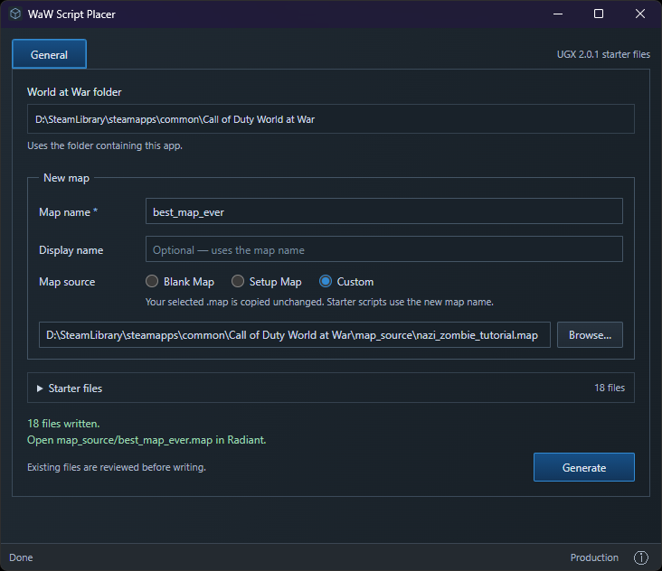
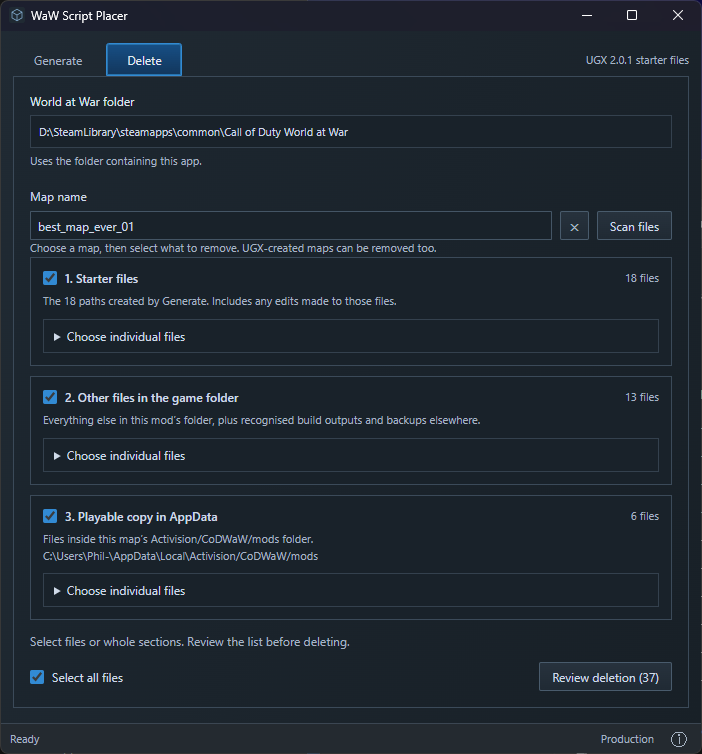
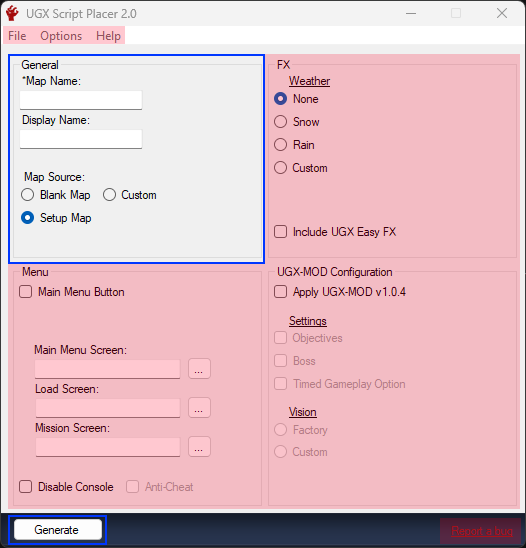

# WaW Script Placer

**An unofficial community app. Not affiliated with Treyarch, Activision or UGX.**

A starter mod/map creator for World at War, with UGX Script Placer 2.0.1 General generation and a Delete tab for cleaning up maps. Made by [phil81334](https://github.com/phil81334), a community member, for the community. Built with JavaScript, Rust, Vite and Tauri.





More screenshots: [Expanded file lists](images/waw-script-placer-delete-tab-fully-expanded.png) · [Deletion review](images/waw-script-placer-delete-tab-review-deletion-popup.png) · [Deletion complete](images/waw-script-placer-delete-tab-successful-deletion-output.png).

## Download and run

1. Have World at War, its Modtools and the UGX patch installed in the same game folder.
2. Open [Releases](https://github.com/phil81334/waw-script-placer/releases/latest). Under **Assets**, download **waw-script-placer.exe**. The source-code ZIP is for development.
3. Put the EXE in the folder containing `CoDWaW.exe`, then double-click it.

You do not need Node.js, Rust or VS Code to use the EXE. Windows needs [WebView2](https://developer.microsoft.com/microsoft-edge/webview2/#download-section), usually already installed; if missing, install its **Evergreen Bootstrapper**.

## Generate a map

Open **Generate**, enter a map name, choose **Blank**, **Setup** or a **Custom** `.map`, then click **Generate**. Display name is optional; leaving it empty uses the map name. Open `map_source/mapname.map` in Radiant, using your chosen map name.

### How does this differ from UGX Script Placer 2.0.1?

**General generation is 1:1: the same 18 starter files, the same contents and the same map-name/display-name substitutions.** Blank, Setup and Custom work from the same starter resources. This is not a modified starter pack.

The UI is new, and overwrite handling is fixed: **Skip** leaves the existing file untouched, **Replace** replaces it, and **Back Up + Replace** keeps a backup first.

**Blue = included. Red = left out.** No FX options, Menu options, UGX-MOD installation, patch installer or registry settings.



Checked against actual UGX-generated Blank, Setup and Custom outputs: all 54 files matched after accounting for the different map names.

## Delete a map

Open **Delete**, choose a map and click **Scan files**. Select individual files or whole sections: **Starter files**, **Other files in the game folder**, and **Playable copy in AppData**. Review the list, then confirm.

Deletion is permanent, including any edits in selected files. The game-folder section includes everything else inside that mod’s folder and recognised map-specific build outputs and backups in shared folders. Unlisted files are left alone.

## Run from source

**Windows setup — do this once.** Skip anything already installed.

| Install | What to choose |
| --- | --- |
| [VS Code](https://code.visualstudio.com/) | The Windows installer. This is where you open the project. |
| [Node.js](https://nodejs.org/en/download) | **LTS**, **Windows**, **Installer (.msi)**. Keep the default options; npm is included. |
| [Microsoft C++ Build Tools](https://visualstudio.microsoft.com/visual-cpp-build-tools/) | In its installer, select **Desktop development with C++**. Keep the selected MSVC tools and Windows SDK. |
| [Rust](https://rust-lang.org/tools/install/) | Download and run **rustup-init.exe (x64)**. Choose the default installation. |

Close and reopen VS Code after installing these. [Tauri's Windows guide](https://v2.tauri.app/start/prerequisites/#windows) has more help. Vite and Tauri are installed by the project; no separate installation or Python is needed.

**Open and run the project:**

1. On this GitHub page, choose **Code → Download ZIP**, then extract it. You can clone it instead if you already use Git.
2. In VS Code, choose **File → Open Folder**. Open the extracted folder containing `package.json`.
3. Choose **Terminal → New Terminal**, then run these commands one at a time:

   ```powershell
   npm install
   npm run dev
   ```

`npm install` downloads the project's dependencies. `npm run dev` opens the desktop app. The first run downloads and compiles Rust dependencies, so give it time. Keep the terminal open; press **Ctrl+C** there to stop development.

Next time, run `npm run dev`, or click the play button beside **dev** in VS Code's **NPM Scripts** panel. If that panel is hidden, right-click the Explorer panel headings and enable **NPM Scripts**.

Development generates and deletes test files inside `.local/test-root`, including a separate test copy of the AppData mod folder. Your installed game and real AppData mods are not selected automatically. No saved game path is needed. Set `WAW_ROOT` before starting development only if you deliberately want another output folder. The packaged EXE always uses its own folder instead.

| Command | What it does |
| --- | --- |
| `npm run dev` | Opens the desktop app for development. |
| `npm run dev:web` | Shows the UI in a browser. Cannot generate, scan or delete map files. |
| `npm run build` | Creates `release/waw-script-placer.exe`. |
| `npm run build:web` | Builds the UI files only. No EXE. |

To make your own EXE, run `npm run build`, then copy `release/waw-script-placer.exe` beside `CoDWaW.exe` in your prepared game folder.

Starter templates come from [UGX Script Placer 2.0.1](https://www.ugx-mods.com/forum/applications-and-tools/36/app-ugx-script-placer-2-0-1-beta-now-with-ugx-mod-compatibility/4221/). See [ATTRIBUTION.md](ATTRIBUTION.md) for credits.

Original app code: [GPL-3.0 licence](LICENSE). Starter templates retain their existing terms.

